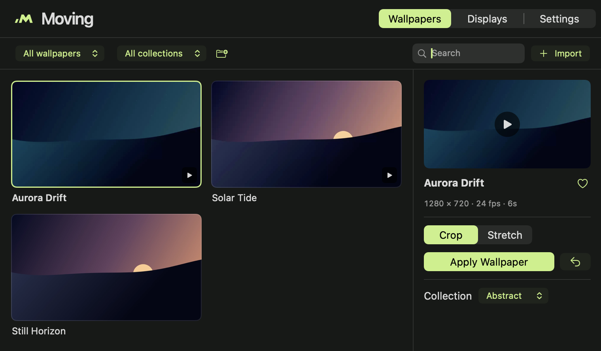

# Moving

Moving is a free, open-source macOS app for video and image wallpapers. Import media from your Mac, choose a fit for each display, and control playback from the menu bar.

[Project website](https://moving.arpanm.xyz/) · [Downloads](https://github.com/arpan-mandal/moving/releases) · [Report an issue](https://github.com/arpan-mandal/moving/issues)



## Features

- Use compatible local MP4 and MOV videos or JPEG, PNG and HEIC images. Three demo wallpapers are included.
- Assign a different wallpaper to each display. Crop preserves the original proportions. Stretch fills the display.
- When a full-screen or maximized window covers the display, Moving holds the current frame and resumes from that point when the desktop is visible again.
- Browse, preview and organize wallpapers in a local library. Pause or switch wallpapers from the menu bar.
- Choose Battery Saver, Balanced or Performance to control playback resolution and frame rate.

The deployment target is macOS 14 Sonoma or later. The universal build contains Apple silicon and Intel executables. Runtime verification was performed on Apple silicon. See the [verification record](Documentation/VERIFICATION.md) for coverage and [known limitations](Documentation/LIMITATIONS.md) for behavior on different setups.

## Install

The [Moving 1.2.0 build 7 prerelease](https://github.com/arpan-mandal/moving/releases/tag/v1.2.0-preview.7) includes a universal DMG and SHA-256 checksum. The DMG is ad hoc signed and intended for local testing. Gatekeeper may block the downloaded build. You can also build the app from source below.

1. Download the DMG and checksum into the same directory. Verify the download with `shasum -a 256 -c Moving-1.2.0-universal.dmg.sha256`.
2. Open the DMG, drag **Moving** into **Applications**, then eject the disk image.
3. Open Moving from Applications. Use its menu bar icon to reopen the **Library**.
4. Choose a bundled wallpaper or **Import** a local file. Select **Crop** or **Stretch**, then click **Apply Wallpaper**.

Use **Displays** to manage individual screens. If a source file moves, use **Locate File**. To return to your macOS wallpaper, use **Restore All Displays** or quit Moving. When upgrading from Motion, quit and remove the old app bundle before opening Moving. The library is stored separately and keeps its original container path.

## Build from source

Use a Mac with Xcode or Apple Command Line Tools and the macOS SDK. The app has no third-party runtime dependencies. The DMG packaging script uses Python 3 and a virtual environment for two pinned Finder layout dependencies.

```sh
git clone https://github.com/arpan-mandal/moving.git
cd moving
./Scripts/build.sh
open Artifacts/Release/Moving.app
```

You can also open `Moving.xcodeproj` in Xcode and select the **Moving** scheme. Set `CONFIGURATION=Debug` for a debug build or `ARCHS=arm64` to build just the Apple silicon slice with the command-line script.

```sh
./Scripts/test.sh
./Scripts/smoke-test.sh
./Scripts/package-dmg.sh
```

Run the tests in a logged-in macOS desktop session. The smoke test uses the Release bundle and an isolated test library. The packaging script writes a DMG and checksum under `Artifacts/Release/`. See [Signing and notarization](Documentation/SIGNING.md) for distribution builds.

## Repository layout

| Path | Contents |
| --- | --- |
| `Sources/` | Native AppKit and SwiftUI app, media library, and desktop playback |
| `Resources/` | App metadata, sandbox entitlements, icons, and demo wallpapers |
| `Tests/` | Core tests and a sandboxed import and playback probe |
| `Scripts/` | Build, test, artwork generation, packaging, and signing |
| `Documentation/` | Architecture, verification, and release notes for maintainers |

Moving keeps its library, thumbnails, and playback cache on your Mac. It reads media selected in the app and creates local playback copies when needed. The app uses no account, telemetry, or cloud sync. See the [architecture notes](Documentation/ARCHITECTURE.md) and [benchmark data](Documentation/benchmarks/1.2.0-build-6/Benchmark.md) for implementation details and measured performance.

## Contributing and license

See [CONTRIBUTING.md](CONTRIBUTING.md), [CHANGELOG.md](CHANGELOG.md), and [SECURITY.md](SECURITY.md). Moving’s code, logo, and bundled demo assets are released under the [MIT License](LICENSE).
